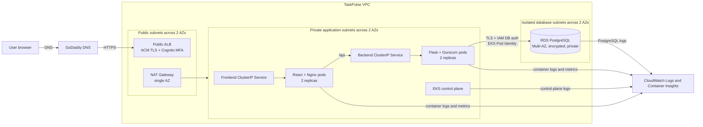

# TaskPulse architecture

This describes the Terraform and Kubernetes production target. DNS is hosted by GoDaddy; it is not Route 53. The browser frontend is served by the EKS pods; S3 and CloudFront are not part of this deployment.

## Current limits

- The Terraform target has one NAT Gateway for both private AZs. It reduces cost but is a cross-AZ dependency and a single point of failure for private-subnet outbound traffic.
- The EKS public API endpoint remains limited to the configured operator IP. Update its CIDR whenever that IP changes.
- The backend has a dedicated Pod Identity role and disables SDK fallback to EC2 instance metadata; review worker-node IMDS settings as part of future node-group hardening.
- CloudWatch receives EKS control-plane, RDS PostgreSQL, and container logs/metrics. Budget and availability alarms still need thresholds and notification recipients.
- Cognito authenticates invited users, but TaskPulse stores one shared board. The app has no per-user ownership or roles.
- The older root-level `infra.webp` is a legacy diagram and does not show this production target.
